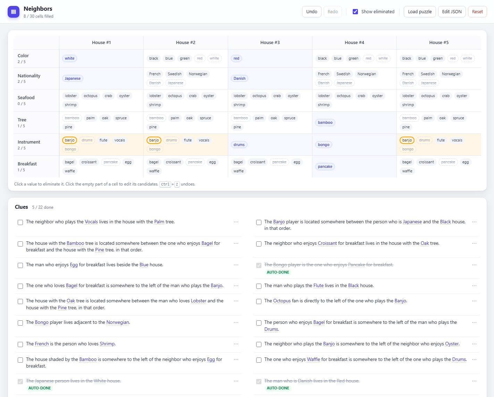

# Zebra / Einstein Riddles

[](https://github.com/ucruz-cs/zebra-riddles-toolkit/actions/workflows/tests.yml)

A local web app for solving zebra / Einstein logic-grid riddles **by elimination, directly in the grid**.

Most playable online logic-grid games only let you select the one value you believe is correct — there is no way to record the candidates you have ruled out. Zebra riddles rarely resolve from a single clue: each clue eliminates a few possibilities, and the useful conclusions appear when the eliminations from many clues are combined. Holding all of that in your head is the hard — and often frustrating — part. This app turns the grid into a visible record of your deductions: every cell starts with the full candidate pool, a click removes a value, and the eliminations stay on screen while you cross-reference the clues.

It does not generate puzzles and it does not solve them for you — it gives a puzzle from any game a place to record deductions so you can spend your attention on the reasoning. Load one of the bundled samples, or transcribe the puzzle you are currently playing (see [Getting a puzzle from a screenshot](#getting-a-puzzle-from-a-screenshot)).



*The Neighbors sample mid-solve: eliminated candidates are struck through, “banjo” is pinned in the clue list so every cell where it is still possible lights up, and satisfied clues are crossed out automatically.*

## Why another logic-grid app?

- **Record deductions, not guesses.** Remove individual candidates as each clue rules them out instead of holding every elimination in your head. **Show eliminated** reveals what you crossed out so you can restore it.
- **Built for combining clues.** Eliminations from one clue stay visible while you work on the next, so later conclusions can build on earlier ones.
- **Clue → grid highlighting.** Hover a value in a clue (or click it to pin) and every cell where that value is still possible lights up. Seeing the candidate chips laid out this way makes it obvious which clue applies to which cells, removing still more tedious mental bookkeeping so you can focus entirely on the logic.
- **Clues react to the grid.** A clue is struck through only when the current table guarantees it, and turns red when the table contradicts it.
- **No hidden solver.** The only automatic deduction is the basic row rule: a value can only occupy one position in its category. No hints, no half-filled answers.
- **Local and dependency-free.** A tiny Node static server, vanilla JS, no accounts and no network calls. Progress is stored in the browser's `localStorage`.

## Run it

```bash
npm start
# http://localhost:3000
```

## Testing

```bash
npm test
```

The suite uses Node's built-in test runner and covers schema validation, candidate propagation, clue evaluation, sample integrity, the solved guard, and the HTTP server. No dependencies are required.

## Using it

- **Grid** — rows are categories, columns are positions. Every cell starts with all values of its row as candidate chips.
  - Click a chip to eliminate it.
  - Turn on **Show eliminated** to see removed chips (dashed, struck through) and click them to restore.
  - Click the empty part of a cell to open the candidate editor: check/uncheck values, or press **only** to keep a single value. Values already placed elsewhere in the row are shown disabled with the position they occupy.
  - When a cell is down to one value, that value is removed from every other cell in the same row, cascading.
- **Clues** — a clue turns grey and struck through when its constraint is fully satisfied by the current grid; it turns red when the grid contradicts it. The checkbox lets you mark a pending clue done manually; clicking it again clears the mark and returns the clue to automatic status.
- **Highlighting** — hovering a value in a clue (or in the grid) highlights every cell where it is still possible. Click a value in a clue to pin the highlight; `Esc` clears it. Values are matched case-insensitively, and ages link both ways: a `38 years` option also highlights `38-year-old` in the text. Eliminated candidates are never highlighted.
- **Undo** — `Ctrl+Z`, redo with `Ctrl+Shift+Z` or `Ctrl+Y`.

The app never solves the puzzle: it only reports what the current table implies.

## Getting a puzzle from a screenshot

The app does not read images. You convert the screenshot into puzzle JSON with your own vision-capable LLM, using the prompt built into the app, then paste the JSON into **Load puzzle**. The prompt already describes the schema, every clue predicate and the common phrasings, so you normally don't need to explain the format to the model.

### 1. Capture the puzzle

Take screenshots that contain:

- the grid header and row labels (for example `House #1 … House #5`, `Color`, `Nationality`, …);
- every clue — both columns and anything below the fold;
- the game's list of possible values for each category, if it shows one.

Several images are fine — tell the model they belong to the same puzzle. Your own progress in the screenshot (filled cells, checked clues) is ignored by the prompt, so the generated puzzle still starts empty.

If the game hides the values inside closed dropdowns, open one dropdown or screenshot the value list. If you cannot get the complete lists, the prompt will ask you for the rest.

### 2. Copy the extraction prompt

Open **Load puzzle** and press **LLM prompt**, then **Copy prompt**. The copied text includes:

- the JSON schema and the rule that each category needs exactly as many values as there are positions;
- every constraint type with its direction (`immediatelyBefore` vs `leftOf`, and so on);
- phrase mappings such as "adjacent" → `nextTo`, "directly to the right" → `immediatelyAfter`, "in one of the corner houses" → `at` + `ends`;
- paraphrase rules such as "a book that features time travel" → `genre:Science fiction` and "the oldest" → `age:max`;
- a missing-information gate: if a value list is incomplete or unreadable, the model must ask you in the chat rather than guess.

### 3. Send it to a vision model

Attach the screenshots to your favourite vision-capable chat model (ChatGPT, Claude, Gemini, …), paste the prompt, and ask for the JSON. A short message such as "These screenshots are the same puzzle — transcribe it following the instructions" is enough. If the model asks for missing values, reply with the complete lists for those categories; it then returns the full JSON.

### 4. Load it and check the result

Paste the answer into **Load puzzle** and press **Load**. Validation problems are listed in the dialog with the specific category or value at fault. Once loaded, check:

- the title, position labels and row order;
- that every category has the number of values you expected;
- that the board starts empty (no filled cells, no checked clues);
- that the number of clues matches the screenshot.

If anything looks wrong, you can click `⋯` on any clue to inspect how its constraint was parsed. You can edit the constraint JSON in the inspector and press **Apply** — no need to reload the whole puzzle.

### Common problems

| Symptom | Fix |
| --- | --- |
| `Invalid JSON: …` | The model wrapped the answer in code fences or added prose. Paste only the `{ … }` object. |
| `Category "X" needs … values` or a value-count message | The value list is incomplete. Ask the model for the full list, or add the missing values to the JSON. |
| `Unknown value "Y" in category "X"` in the clue inspector | A clue reference does not match the value list (spelling or capitalisation). Fix the value or the reference. |
| A clue shows **needs constraint** | The model left `constraints: []`. Encode it in the inspector, or ask the model to redo that clue. |
| A clue is auto-done immediately, or turns red | The constraint is too weak or points at the wrong value. Open `⋯` and correct it. |

## Puzzle JSON reference

The loader expects one object per puzzle:

```json
{
  "title": "Passengers",
  "positions": { "label": "Passenger", "labels": ["#1", "#2", "#3", "#4"] },
  "categories": [
    { "id": "shirt", "label": "Shirt", "values": ["Pink", "Red", "Black", "Yellow"] },
    { "id": "name", "label": "Name", "values": ["Gabriel", "Owen", "Eugene", "Quentin"] }
  ],
  "clues": [
    {
      "id": "c1",
      "text": "The passenger watching the Horror movie is in position 2.",
      "constraints": [{ "type": "at", "subject": "movie:Horror", "positions": [2] }]
    }
  ]
}
```

### Rules

- Every category must have exactly as many values as there are positions. If `positions.labels` is omitted, labels `#1…#N` are generated.
- `id` is optional; it defaults to a slug of the label. `values` may also be written as `options`, `label` as `name`.
- Clue `id` is optional. `text` is required.
- `constraints` may be an array (`constraint` is accepted for a single object). An empty array is allowed: the clue then counts as done once every value it names has exactly one possible position.

### Constraint catalog

References are `"categoryId:Value"`, case-insensitive. Positions are 1-based.

| Type | Shape | Meaning |
| --- | --- | --- |
| `at` | `{ "type":"at", "subject":"REF", "positions":"ends"\|"first"\|"last"\|"middle"\|[1,4] }` | subject is one of those positions |
| `same` | `{ "type":"same", "a":"REF", "b":"REF" }` | both values share a position |
| `nextTo` | `{ "type":"nextTo", "a":"REF", "b":"REF" }` | adjacent, either direction |
| `immediatelyBefore` | `{ "type":"immediatelyBefore", "a":"REF", "b":"REF" }` | `b` is directly after `a` |
| `immediatelyAfter` | `{ "type":"immediatelyAfter", "a":"REF", "b":"REF" }` | `a` is directly after `b` |
| `leftOf` | `{ "type":"leftOf", "a":"REF", "b":"REF" }` | `a` somewhere left of `b` |
| `rightOf` | `{ "type":"rightOf", "a":"REF", "b":"REF" }` | `a` somewhere right of `b` |
| `between` | `{ "type":"between", "subject":"REF", "after":"REF", "before":"REF" }` | `after < subject < before` |

`"somewhere between A and B, in that order"` maps to `between` with `after: A`, `before: B`; it does not mean adjacent.

Superlatives resolve inside a category: `"age:max"` is the highest numeric value, `"age:min"` the lowest.

### Bundled samples

There are five bundled puzzles behind **Load puzzle → Load sample**: *Tiny 1×4* (4 positions, 1 category, 4 clues) — a trivial grid for testing, *Passengers* (4 positions, 4 categories, 11 clues), *Librarians* (5 positions, 6 categories, 22 clues), *Neighbors* (5 positions, 6 categories, 22 clues) and *Houses* (5 positions, 6 categories, 25 clues). Picking one fills the editor; press **Load** to start it. **Choose file** works the same way with a JSON file on disk.

## Files

```text
zebra/
├── package.json            npm scripts: start, dev, test; Node >= 18
├── server.mjs              zero-dependency static server
├── README.md
├── LICENSE                 MIT license
├── .gitignore
├── test/                   node:test suite
├── test-support/           shared test fixtures
├── .github/
│   └── workflows/
│       └── tests.yml       CI: npm test on Node 20/22/24
├── docs/
│   └── screenshot.png      README screenshot
├── samples/
│   ├── tiny.json           1×4 test grid
│   ├── passengers.json     4 positions · 4 categories · 11 clues
│   ├── librarians.json     5 positions · 6 categories · 22 clues
│   ├── neighbors.json      5 positions · 6 categories · 22 clues
│   └── houses.json         5 positions · 6 categories · 25 clues
└── public/
    ├── index.html          app shell, toolbar, dialogs, solved overlay
    ├── app.css             layout, grid, clues, modals, confetti
    └── js/
        ├── main.js         boot: restore session or load a sample
        ├── schema.js       puzzle validation and normalization
        ├── clues.js        references, predicates, clue evaluation, text links
        ├── state.js        candidate domains, row propagation, undo/redo
        ├── storage.js      localStorage save and restore
        ├── ui.js           rendering, events, solved feedback
        └── prompt.js       copyable LLM extraction prompt
```

## License

MIT — see [LICENSE](LICENSE).
